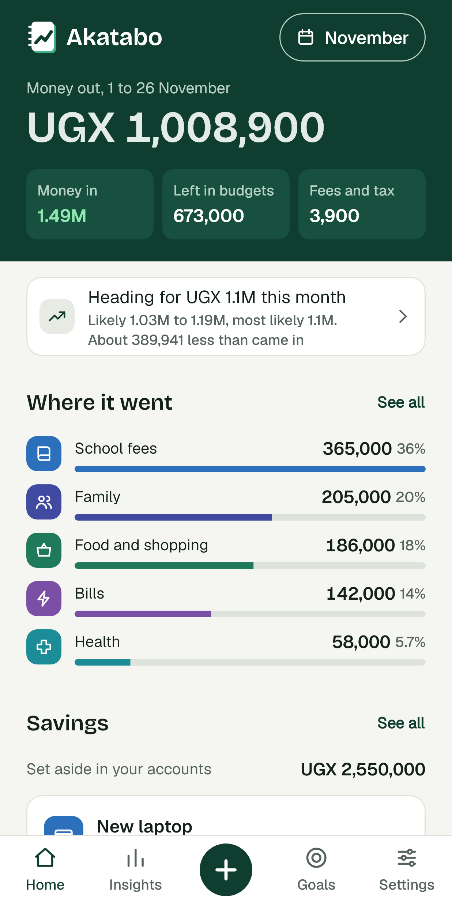
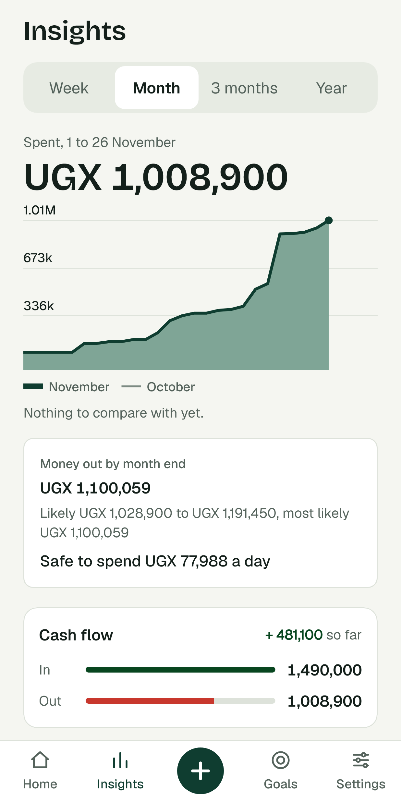
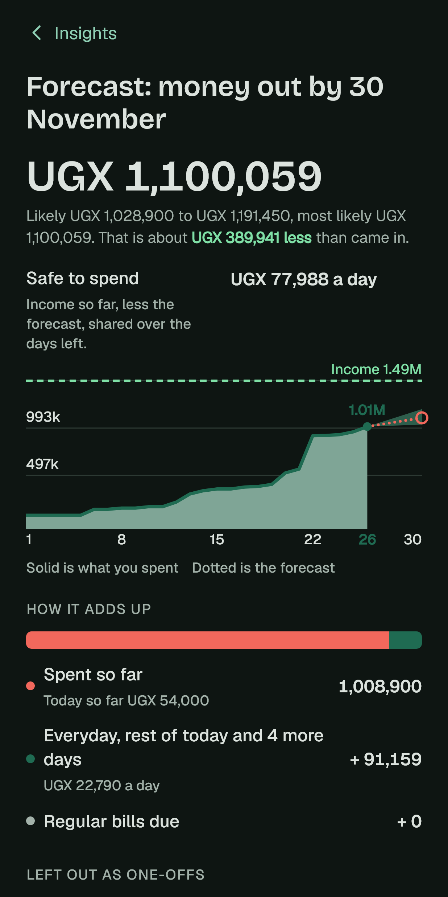
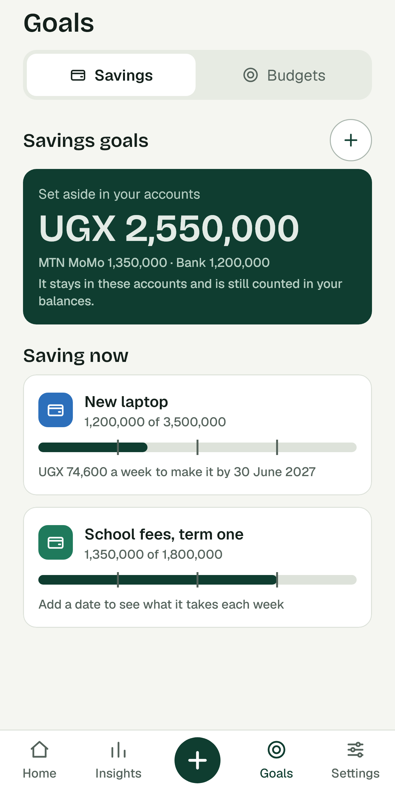
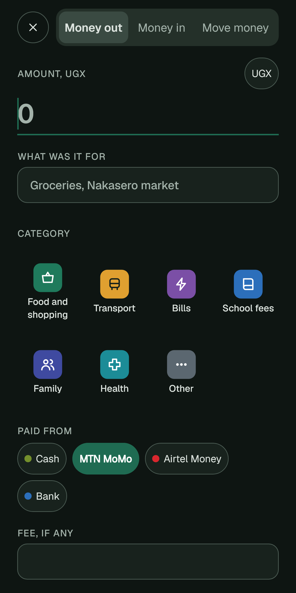
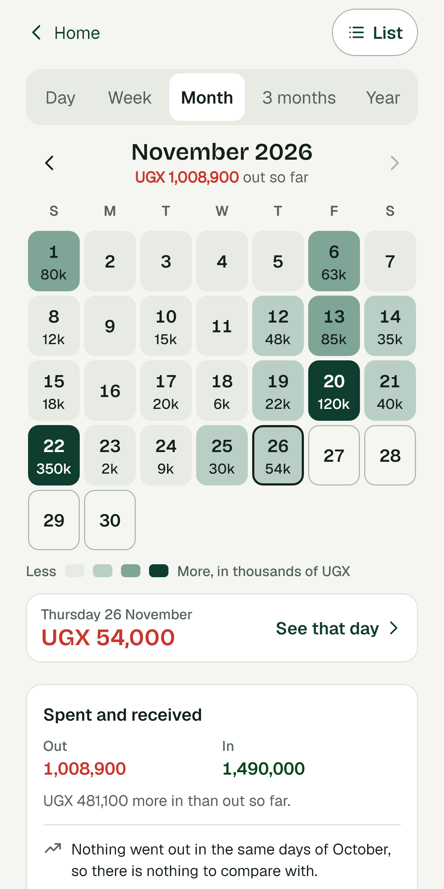
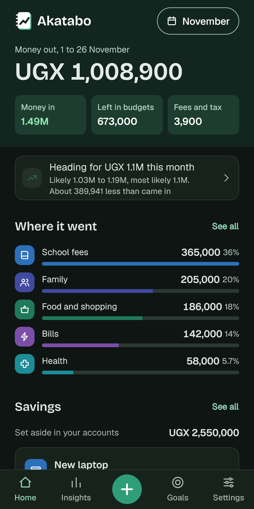
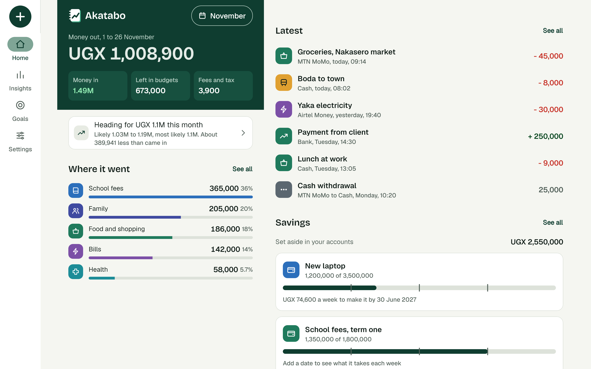
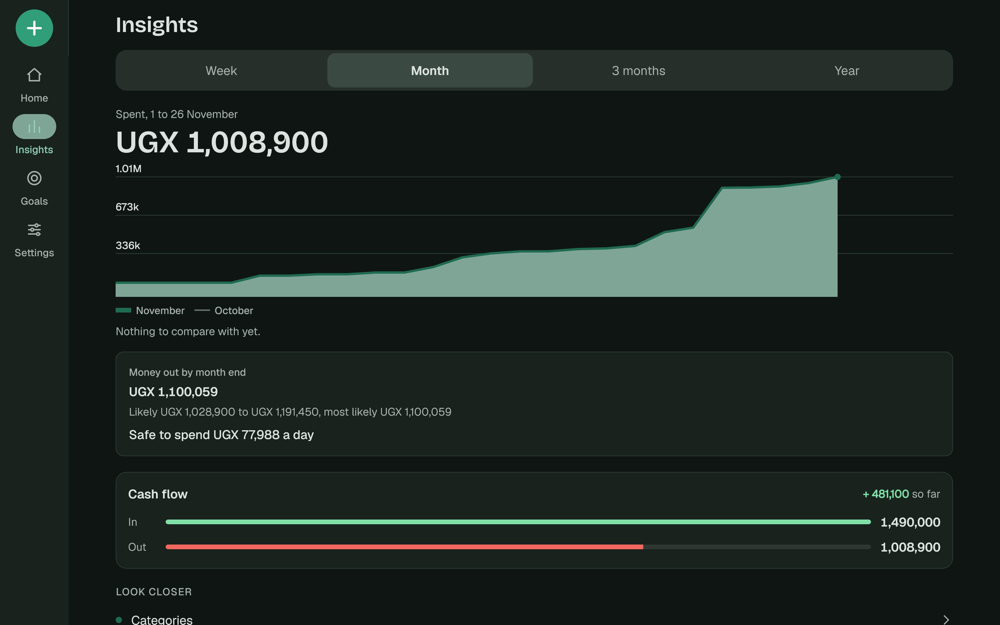

<p align="center">
  <picture>
    <source media="(prefers-color-scheme: dark)" srcset="design/brand/banner-dark.png">
    
  </picture>
</p>

# Akatabo

A free money tracker for Uganda that works without the internet. Add what you spend and what you receive, and Akatabo shows where the money went, what it cost in fees, how your budgets and savings are doing and where the month is heading.

There is no account, no advert and no tracking. The app cannot reach the internet, so your records stay on your phone.

[](https://github.com/AshabaJasper/akatabo/actions/workflows/ci.yml)
[](LICENSE)


<table>
  <tr>
    <td></td>
    <td></td>
    <td></td>
    <td></td>
  </tr>
</table>

<sub>Screenshots use made-up entries. They are drawn from the real app by a test; see [Screenshots](#screenshots).</sub>

## Status

Version 0.2.0, for Android. The app works end to end and has been tested on an Android 16 emulator and a Pixel phone. It is not on Google Play or F-Droid yet. Install links will be added here when the listings are live. Until then you can build it yourself (see below).

Tablets and foldables get their own layout. It is covered by tests at tablet sizes and with folds in each position, but it has not yet been tried on a real tablet or foldable.

An iOS project is in place but has not been built, because the work so far has been done without a Mac.

## What it does

- **Record every shilling.** Money out, money in and moves between accounts (cash, mobile money, bank), with fees and tax kept on each entry.
- **Goals.** Savings goals with a target, a date and the pace you need, and budgets per category with a warning before you reach the limit and an option to carry over what is left. Both sit on the Goals tab.
- **A forecast for the month:** where spending is heading, a safe amount to spend per day, and the regular payments it is counting.
- **Insights and a calendar** that show where the money went, what changed against last month, and which fees you paid.
- **Regular payments** such as rent and airtime, noticed from your history, with a reminder the day before.
- **Other currencies.** Type the rate you were given; the entry is kept in shillings, and it remembers the amount and the rate you used.
- **Reports** as PDF, CSV and Excel files, and **backups** as a single `.akatabo` file you can protect with a password.
- **App lock** with a PIN, and fingerprint or face unlock where the phone has it. Amounts can be hidden on screen and in the app switcher.
- **Reminders** for the daily entry, budgets, savings goals and regular payments.
- **Phones, tablets and foldables.** On a wide screen the tabs move to a side rail and Home shows the latest entries and savings beside the summary. On a foldable, Home splits its two panes at the fold, and the tab screens keep clear of a half-open fold.
- **Made to be read.** Light and dark themes, a text size setting, red and green for money out and in with an option for orange and blue, and screen reader support.

Four small models run on the phone to suggest a category, forecast the month, flag unusual payments and spot regular ones. They learn from your own entries and send nothing anywhere.

## A closer look

<table>
  <tr>
    <td width="33%" valign="top"></td>
    <td width="33%" valign="top"></td>
    <td width="33%" valign="top"></td>
  </tr>
  <tr>
    <td valign="top"><b>Add</b> takes a few taps: the amount, a few words, the category and the account. Fees and tax go on the same entry, and the category is suggested from what you typed.</td>
    <td valign="top"><b>Calendar</b> shades each day by how much went out. Tap a day to see its entries, or switch to a week, three months or a year.</td>
    <td valign="top"><b>Dark mode</b> follows the phone or can be set in Appearance, along with the main colour, corners and text size.</td>
  </tr>
</table>

On a tablet or an unfolded foldable, the same app uses the extra width:





## Your data stays on your phone

- The release build has no `INTERNET` permission. It asks only for notifications (reminders) and for fingerprint or face (app lock), and both are optional.
- Everything is stored in the app's private folder. Android cloud backup is switched off.
- You decide what leaves the phone: a backup or report file is made only when you ask for one.

The privacy policy is in [`docs/privacy.md`](docs/privacy.md) and is being finalised before the first store release.

## Build it yourself

You need Flutter 3.50 (stable), JDK 17 and the Android SDK (platforms 36 and 37). Then, from the repository root:

```powershell
cd app
flutter pub get
flutter analyze
flutter test
flutter run
```

To try the app with sample entries, run a debug build with `--dart-define=AKATABO_DEMO=true`. Release builds never add sample data. The release build, the device journey test, code generation and the logo are described in [`app/README.md`](app/README.md).

The goldens (screenshot tests) are made on Windows and only match there. CI runs them on a Windows job and runs everything else on Linux.

### Screenshots

The images in this README and in the store listings are drawn by [`app/test/screenshots/readme_screenshots_test.dart`](app/test/screenshots/readme_screenshots_test.dart). It runs the real app on an in-memory database filled with the demo entries, on a fixed date, at three times the screen density. It never touches a phone. To draw them again on Windows, from `app/`:

```powershell
$env:AKATABO_SCREENSHOTS = '1'; flutter test test/screenshots; Remove-Item Env:AKATABO_SCREENSHOTS
```

The images go to [`docs/screenshots/`](docs/screenshots/), and numbered copies go to `fastlane/metadata/android/en-US/images/` for F-Droid and IzzyOnDroid. Without the variable the test is skipped, so `flutter test` and CI never write images.

## How it is built

- **Flutter and Dart**, with Riverpod for state, drift (SQLite) for storage and go_router for navigation.
- **Design tokens.** Every colour, type style, size and radius comes from [`design/tokens.json`](design/tokens.json). A test fails if a screen types one by hand.
- **No Material icon font.** Every icon is a vector drawn in code, so the app is small and looks the same on every phone.
- **One layout that adapts.** At 840dp wide or more, the bottom bar becomes a navigation rail and the content is capped and centred. Folds and hinges come from Flutter's display features, so a fold sets where Home's two panes split, and on a half-open phone the tab screens stay on one half. Screens opened on top of the tabs, such as Add and Settings pages, do not avoid a fold yet. See [`app/lib/app/adaptive.dart`](app/lib/app/adaptive.dart).
- **Calculations apart from screens.** The money rules and the four models live in `app/lib/domain/` and `app/lib/smart/`, with no Flutter imports, so they can be tested alone. The models are trained in Python (`ml/`) and exported into the app.

## What is in this repository

| Path | What it is |
| --- | --- |
| `app/` | The Flutter app. Start with [`app/README.md`](app/README.md). |
| `design/` | The design: [`DESIGN_SYSTEM.md`](design/DESIGN_SYSTEM.md) (the rules), `tokens.json`, one HTML file per screen in `design/screens/`, and the brand files. Open `design/index.html` for the gallery. |
| `ml/` | Training, parity tests and exports for the on-device models. |
| `fastlane/` | Store text, graphics and screenshots, used by F-Droid, IzzyOnDroid and Google Play. |
| `docs/` | The screenshots, the draft privacy policy, the F-Droid packaging notes and the list of known bugs. See [`docs/README.md`](docs/README.md). |

### Development notes

These record how the app was planned and built, including what was tested and what was not.

- [`CHANGELOG.md`](CHANGELOG.md): what changed in each version.
- [`PRODUCT.md`](PRODUCT.md): who the app is for and how it should feel.
- [`PLAN.md`](PLAN.md): the build plan and the decisions made along the way.
- [`PROGRESS.md`](PROGRESS.md): what each phase delivered and how it was checked.
- [`SHIP_GATE.md`](SHIP_GATE.md): the launch checklist, with evidence for each item.
- [`docs/BUGS.md`](docs/BUGS.md): known bugs and how to trigger each one.

## Contributing

Bug reports and fixes are welcome. Please read [`CONTRIBUTING.md`](CONTRIBUTING.md) first; it covers how to build and test, the design token and privacy rules, screen sizes, screenshots, commit messages and pull requests. Everyone taking part follows the [Code of Conduct](CODE_OF_CONDUCT.md).

To report a security problem, follow [`SECURITY.md`](SECURITY.md) and do not open a public issue.

## Licence

The code is licensed under the [GNU General Public License v3.0](LICENSE) (GPL-3.0-only). The brand files in `design/brand/` are licensed under [CC BY-SA 4.0](https://creativecommons.org/licenses/by-sa/4.0/). Forks are welcome under these licences; please give a fork its own name and icon so people can tell the two apart. See [`design/brand/README.md`](design/brand/README.md).

## About the name

"Akatabo" is Luganda for "little book".
